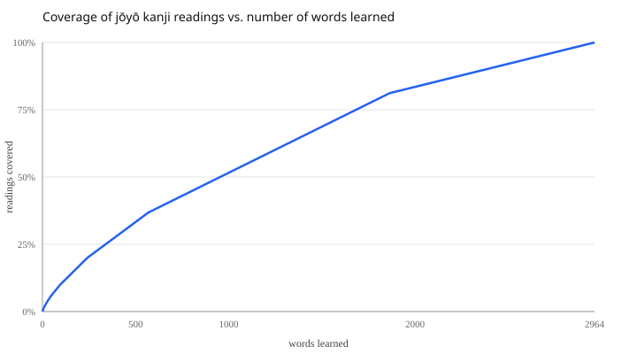

# 2.964 Kata: Kosakata Minimum untuk Menutup Seluruh Bacaan Kanji Jōyō

Analisis komputasional untuk menjawab: berapa banyak kata berkanji yang harus dihafal supaya **semua bacaan dari 2.136 kanji jōyō** (dan otomatis seluruh kyōiku) tertutup?

Jawabannya, dihitung sebagai *minimum set cover* atas JMdict dan KANJIDIC2:

> **2.964 kata** — terbukti optimal di rentang **2.962–2.964** (gap < 0,1%).

Ini bukan daftar hafalan yang disusun feeling; ini minimum matematis dari model yang eksplisit, dipublikasikan bersama data dan kode yang menghasilkannya.

---

## Ringkasan

| Item | Nilai |
|---|---|
| Unit bacaan yang harus ditutup | **6.587** (2.854 on'yomi + 3.733 kun'yomi) |
| Bacaan **tanpa** kata pendukung di JMdict | 747 (terverifikasi: 709) |
| Bacaan yang bisa ditutup | **5.840** |
| **Jumlah kata minimum** | **2.964** |
| Batas bawah terbukti | 2.962 |
| Efisiensi | 2,48 bacaan per kata |
| Kata yang mengajarkan 1 bacaan saja | 580 |
| Bacaan terbanyak dari satu kata | 14 |

---

## Masalahnya

Menghafal 手紙 (てがみ) berarti belajar 手 = て dan 紙 = かみ. Jadi setiap kata *menutup* satu bacaan untuk tiap kanji yang dikandungnya — selama bacaannya komposisional. Pertanyaannya:

> Berapa himpunan kata terkecil yang gabungan cakupannya sama dengan seluruh bacaan kanji jōyō?

Secara formal, dengan

- **U** = himpunan pasangan (kanji, bacaan),
- **S** = himpunan kata JMdict, masing-masing menutup subset dari U,

cari *S'* ⊆ *S* terkecil dengan ∪*S'* = *U*.

Ini adalah **minimum set cover**, yang NP-hard. Kita selesaikan secara eksak sampai gap 0,1% memakai reduksi + integer programming.

---

## Data

| Sumber | Versi | Ukuran |
|---|---|---|
| [JMdict](https://www.edrdg.org/jmdict/j_jmdict.html) (`JMdict_english.zip`, build Yomitan) | 2026-11-15 | 527.868 baris / 231.653 entri |
| [KANJIDIC2](https://www.edrdg.org/wiki/index.php/KANJIDIC_Project) | database 2026-320 | 13.108 kanji |

JMdict dipilih dibanding Jitendex dan JPDB karena punya entri asli terbanyak (231.653 vs 210.521; JPDB bahkan bukan kamus definisi) dan basis data paling baru. Jitendex diturunkan dari JMdict; tambahan ±136.000 headword-nya adalah varian tulisan lama (kyūjitai) yang tidak mengajarkan bacaan baru.

---

## Metode (ringkas)

1. **Normalisasi bacaan** — katakana → hiragana, pisahkan okurigana pada `.`, buang penanda afiks, gabungkan duplikat (`う.まれる` = `うま.れる`). Hasil: **6.587 unit**.
2. **Penyelarasan kata–bacaan** — tiap kanji dalam kata harus "membayar" potongan bacaan yang cocok. Aturan: on'yomi persis, kun stem + okurigana, rendaku (手紙 てがみ), sokuon (学校 がっこう), tanda 々.
   Jukujikun (大人 おとな, 今日 きょう) otomatis gagal dan dilewati.
   Hasil: **295.396 dari 380.742** kata selaras (77,6%), **138.978** pola coverage unik.
3. **Reduksi** — buang unit tanpa kandidat (747); ambil elemen paksa (654 kata, satu-satunya saksi untuk bacaan tertentu); buang himpunan terdominasi (138.023 → 86.981 variabel).
4. **Optimasi** — relaksasi LP memberi batas bawah; HiGHS menyelesaikan ILP. 654 + 2.310 = **2.964**; batas bawah 654 + 2.307,09 = **2.961,09** (→ 2.962).
5. **Verifikasi** — 5.840/5.840 unit tertutup, tanpa duplikasi, local search tidak menemukan solusi lebih baik.

Detail lengkap: [`docs/metode.md`](docs/metode.md) · laporan panjang: [`docs/laporan.md`](docs/laporan.md).

---

## Hasil



| Bacaan tertutup | Kata dibutuhkan |
|---|---|
| 50% | 792 |
| 70% | 1.298 |
| 80% | 1.527 |
| 90% | 1.758 |
| 95% | 1.858 |
| 99% | 2.060 |
| **100%** | **2.964** |

1% terakhir (58 bacaan) menelan ± **900 kata**. Itu bacaan arkais/ateji yang hanya hidup di kosakata langka.

### Bentuk daftarnya

- 2.964 kata, 2.930 unik (34 kata muncul dua kali dengan bacaan berbeda, mis. 生 き / 生 なま).
- 580 kata mengajarkan tepat satu bacaan; 1.282 mengajarkan dua; maksimum 14.
- ± 430 entri berupa frasa (mis. 真偽を確かめる), karena JMdict memuat ungkapan multi-kata.
- Kata umum seperti 食べる atau 学校 **tidak** ada di daftar — bacaannya sudah tertutup kata lain yang lebih efisien.

### Kyōiku saja

3.409 unit bacaan; 250 mustahil; 3.159 bisa ditutup. Solusi terbaik yang diketahui: **1.710 kata**, batas bawah LP 1.486. Belum terbukti optimal.

---

## Keterbatasan

- "Semua bacaan" berarti **semua bacaan yang terdaftar di KANJIDIC2**, termasuk yang arkais dan langka. Ini bukan klaim tentang pemakaian bahasa Jepang modern.
- 709 bacaan **tidak punya kata pendukung** sama sekali di JMdict (`圧 えん`, `医 いやす`, `米 めえとる` = メートル, …). Tidak bisa dipelajari lewat kosakata.
- Penyelarasan bersifat heuristik; 38 kasus batas (mis. 三つ みっつ) diketahui terlewat, yang bisa menggeser hasil maksimal 38 kata.
- Solver menemukan salah satu dari beberapa solusi optimal berukuran sama; menjalankan ulang bisa menghasilkan himpunan berbeda dengan ukuran sama.
- Tanpa pembobotan frekuensi: solusi minimum didominasi kata langka, sehingga buruk sebagai urutan belajar. Urutkan sendiri berdasarkan frekuensi.

Pembahasan lengkap: [`docs/keterbatasan.md`](docs/keterbatasan.md).

---

## Reproduksi

```bash
pip install -r requirements.txt

# letakkan file sumber di sini
#   data/raw/kanjidic2.xml.gz
#   data/raw/JMdict_english.zip

python scripts/01_extract_readings.py
python scripts/02_align_words.py
python scripts/03_solve_cover.py --time-limit 300   # ~6 menit
python scripts/04_export.py
```

Keluaran: `data/kosakata_2964.json`, `data/readings_universe.json`, `data/stats.json`, `docs/coverage-curve.svg`.

Waktu jalan: ± 10 menit di laptop (penyelarasan ± 3 menit, ILP ± 5 menit).

---

## Lisensi

- **Kode** (`scripts/`): MIT — lihat [`LICENSE`](LICENSE).
- **Data** (`data/`): CC BY-SA 4.0 — lihat [`LICENSE-DATA`](LICENSE-DATA).
  Diturunkan dari JMdict dan KANJIDIC2, © Electronic Dictionary Research and Development Group (EDRDG), dipakai di bawah CC BY-SA 4.0.
