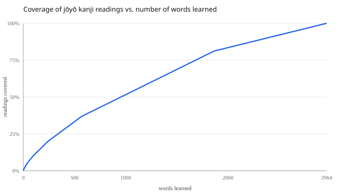

# 2,964 Words: The Minimum Vocabulary to Cover Every Jōyō Kanji Reading

A computational analysis of how many kanji-containing words you must learn so that **every reading of the 2,136 jōyō kanji** (and therefore every kyōiku kanji) is covered at least once.

The answer, derived as a minimum set cover problem over JMdict and KANJIDIC2:

> **2,964 words** — proven optimal within **2,962–2,964** (gap < 0.1%).

This is not a study list someone curated by feel; it is the mathematical minimum under an explicit model, published together with the data and the code that produces it.

---

## TL;DR

| Item | Value |
|---|---|
| Reading units to cover | **6,587** (2,854 on'yomi + 3,733 kun'yomi) |
| Readings with **no** supporting word in JMdict | 747 (verified: 709) |
| Readings that can be covered | **5,840** |
| **Minimum words** | **2,964** |
| Proven lower bound | 2,962 |
| Efficiency | 2.26 readings per word |
| Words that teach only 1 reading | 917 |
| Max readings taught by one word | 14 |

---

## The problem

Learning a word like 手紙 (てがみ) teaches 手 = て and 紙 = かみ. Each word therefore *covers* one reading for every kanji it contains — as long as the reading is compositional. The question is:

> What is the smallest set of words whose coverage union equals all readings of the jōyō kanji?

Formally, with

- **U** = set of (kanji, reading) pairs,
- **S** = set of JMdict words, each covering a subset of U,

find the smallest *S'* ⊆ *S* with ∪*S'* = *U*.

This is **minimum set cover**, which is NP-hard. We solve it exactly up to a 0.1% gap using reduction + integer programming.

---

## Data

| Source | Version | Size |
|---|---|---|
| [JMdict](https://www.edrdg.org/jmdict/j_jmdict.html) (`JMdict_english.zip`, Yomitan build) | 2026-11-15 | 527,868 rows / 231,653 entries |
| [KANJIDIC2](https://www.edrdg.org/wiki/index.php/KANJIDIC_Project) | database 2026-320 | 13,108 kanji |

JMdict was chosen over Jitendex and JPDB because it has the largest number of genuine entries (231,653 vs 210,521 vs — for JPDB — no definitions at all), and the most recent base. Jitendex is derived from JMdict; its extra 136,000 headwords are old orthographic variants (kyūjitai), which do not teach new readings.

---

## Method (summary)

1. **Normalise readings** — katakana → hiragana, split okurigana at `.`, drop affix markers, merge duplicates (`う.まれる` = `うま.れる`). Result: **6,587 units**.
2. **Align words to readings** — each kanji in a word must consume a matching slice of the word's reading. Rules: exact on'yomi, kun stem + okurigana, rendaku (手紙 てがみ), sokuon (学校 がっこう), iteration mark 々.
   Jukujikun (大人 おとな, 今日 きょう) fail by construction and are skipped.
   Result: **295,396 of 380,742** words aligned (77.6%), **138,978** distinct coverage patterns.
3. **Reduce** — drop units with no candidate (747); take forced elements (654 words, each the only witness for some reading); remove dominated sets (138,023 → 86,981 variables).
4. **Solve** — LP relaxation gives a lower bound; HiGHS solves the ILP. 654 + 2,310 = **2,964**; LP bound 654 + 2,307.09 = **2,961.09** (→ 2,962).
5. **Verify** — all 5,840 coverable units covered, no duplicate picks, local search finds no improvement.

Full details: [`docs/metode.md`](docs/metode.md) · Indonesian version: [`docs/laporan.md`](docs/laporan.md).

---

## Results



| Readings covered | Words needed |
|---|---|
| 50% | 954 |
| 70% | 1,538 |
| 80% | 1,830 |
| 90% | 2,380 |
| 95% | 2,672 |
| 99% | 2,906 |
| **100%** | **2,964** |

Beyond 90%, each extra percent costs roughly 60 words: the final 584 readings need 584 words, almost one word per reading, because those readings are witnessed by only one or two words each.

### What the list looks like

- 2,964 words, 2,930 unique (34 words appear twice with different readings, e.g. 生 き / 生 なま).
- 917 words teach exactly one reading; 1,156 teach two; the maximum is 14.
- About 320 entries are phrases (e.g. 真偽を確かめる), because JMdict contains multiword expressions.
- Common words such as 食べる or 学校 are **not** in the list — their readings are covered more cheaply by other words.

### Kyōiku only

3,409 reading units; 250 impossible; 3,159 coverable. Best known solution: **1,710 words**, LP bound 1,486. Not proven optimal.

---

## Limitations

- "All readings" means **all readings listed by KANJIDIC2**, including archaic and rare ones. It is not a claim about modern usage.
- 709 readings have **no supporting word** in JMdict at all (`圧 えん`, `医 いやす`, `米 めえとる` = メートル, …). They cannot be learned through vocabulary.
- The alignment is heuristic; 38 edge cases (e.g. 三つ みっつ) are known to be missed, which can shift the result by at most 38 words.
- The solver finds one of several equally sized optimal solutions; re-running may return a different set of the same size.
- No frequency weighting: the minimum is dominated by rare words, which makes it a poor study order. Sort the list yourself by frequency.

See [`docs/keterbatasan.md`](docs/keterbatasan.md) for the full discussion.

---

## Reproduce

```bash
pip install -r requirements.txt

# put the source files here
#   data/raw/kanjidic2.xml.gz
#   data/raw/JMdict_english.zip

python scripts/01_extract_readings.py
python scripts/02_align_words.py
python scripts/03_solve_cover.py --time-limit 300   # ~6 min
python scripts/04_export.py
```

Output: `data/kosakata_2964.json`, `data/readings_universe.json`, `data/stats.json`, `docs/coverage-curve.svg`.

Runtime: ~10 minutes on a laptop (alignment ~3 min, ILP ~5 min).

---

## Files

| Path | Content |
|---|---|
| `data/kosakata_2964.json` | the result: `{kosakata, bacaan}` × 2,964 |
| `data/readings_universe.json` | all 6,587 units + coverage status |
| `data/stats.json` | all aggregate numbers |
| `scripts/` | the full pipeline |
| `docs/` | method, limitations, report, chart |

---

## License

- **Code** (`scripts/`): MIT — see [`LICENSE`](LICENSE).
- **Data** (`data/`): CC BY-SA 4.0 — see [`LICENSE-DATA`](LICENSE-DATA).
  Derived from JMdict and KANJIDIC2, © Electronic Dictionary Research and Development Group (EDRDG), used under CC BY-SA 4.0.
